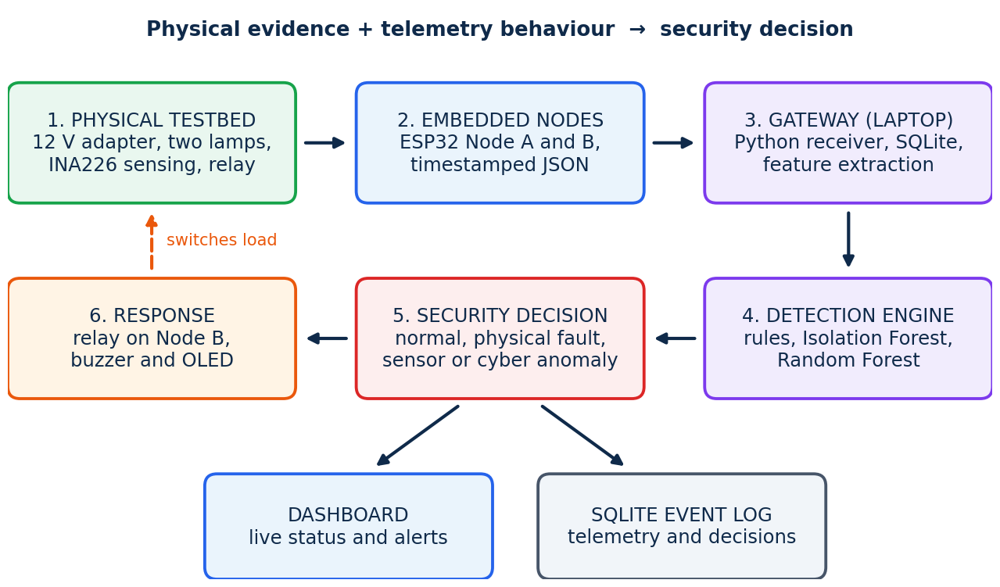
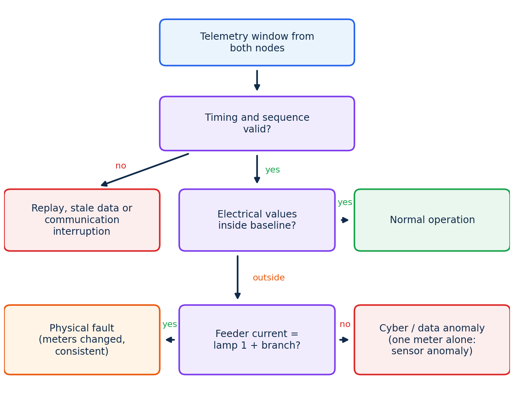

<div align="center">

# GridSentinel Edge

### AI-Assisted Cyberattack Detection for a Smart-Grid IoT Testbed

<p>
  
  
  
  
  
</p>

**A cyber-physical security prototype that monitors electrical measurements, analyses telemetry behaviour, and flags suspicious activity across a small two-node smart-grid testbed.**

[Architecture](#system-architecture) · [Getting Started](#getting-started) · [Detection](#detection-and-classification) · [Experiments](#running-experiments) · [API](#gateway-api) · [Tests](#testing)

</div>

---

## Overview

GridSentinel Edge is an academic cyber-physical security project built around a low-voltage **12 V DC electrical testbed**. Two ESP32 nodes collect measurements from the feeder and a relay-controlled branch. They transmit timestamped telemetry over Wi-Fi to a Python gateway, where the data is stored, analysed, and presented in a Streamlit dashboard.

The detection pipeline combines **measurement consistency checks, statistical rules, communication-health checks, and optional machine-learning models**. Its purpose is to explore how physical measurements and telemetry behaviour can help distinguish normal operation from electrical disturbances, sensor issues, replayed or stale messages, communication loss, and manipulated data.

> **Project scope:** This is a research and learning prototype for a small DC testbed. It is not a certified protection relay, a production SCADA security product, or a system for connecting directly to utility infrastructure.

## What it does

| Capability | Description |
|---|---|
| Two-node monitoring | Node A measures feeder conditions; Node B measures the switched branch and controls the relay. |
| Live telemetry | ESP32 nodes send voltage, current, power, sequence, uptime, and communication information to the gateway. |
| Physical consistency checks | Compares feeder and branch measurements, voltage readings, relay state, and learned normal baselines. |
| Communication checks | Looks for missing, repeated, delayed, stale, or interrupted telemetry. |
| Hybrid detection | Applies deterministic rules and can additionally score windows with Isolation Forest and Random Forest models. |
| Scenario testing | Supports normal operation, physical load changes, false-data injection, sensor drift, replay, and communication interruption experiments. |
| Local event storage | Saves telemetry, experiment runs, commands, and state changes in SQLite. |
| Dashboard and response | Displays live node status, measurements, alerts, experiment history, events, and system setup; can queue relay and buzzer commands. |

## System architecture



### Data flow

1. **Physical testbed:** A 12 V supply powers two lamps. Lamp 2 is controlled through a relay.
2. **ESP32 Node A — feeder:** Reads the INA226 feeder measurement and a separate voltage-sensor measurement.
3. **ESP32 Node B — branch and response:** Reads the branch INA226, reports relay state, and can operate the relay, buzzer, and OLED.
4. **Gateway:** A FastAPI service receives JSON telemetry, tracks short time windows, stores records in SQLite, and runs the detection engine.
5. **Detection engine:** Rule checks analyse electrical ranges, changes, cross-meter residuals, voltage disagreement, sequence numbers, and message timing. Trained models can provide additional anomaly scores or a high-confidence label.
6. **Dashboard and response:** Streamlit displays status and experiments. The gateway can queue supported commands for Node B.

### Main components

| Component | Responsibility | Implementation |
|---|---|---|
| Node A | Feeder voltage/current/power telemetry | ESP32, INA226, voltage sensor |
| Node B | Branch telemetry and physical response | ESP32, INA226, relay, buzzer, OLED |
| Gateway API | Receives telemetry and exposes status/command/experiment endpoints | FastAPI, Pydantic, Uvicorn |
| Detection engine | Builds time-window features and classifies rule flags | Python, NumPy |
| ML models | Unsupervised anomaly scoring and supervised classification | scikit-learn, joblib |
| Storage | Persists telemetry, experiments, events, and commands | SQLite |
| Dashboard | Live monitoring, experiment controls, event history, system view | Streamlit, Pandas, Altair |

## Detection and classification

The gateway analyses measurements in rolling windows. The default configuration uses a **0.5-second sampling period**, a **10-second analysis window**, and a detection/watchdog cycle of approximately one second. Tune these values together with the firmware sampling period and the actual hardware behaviour.

### Detection signals

- **Electrical range checks:** Bus voltage and current are checked against configured operating limits.
- **Step/change checks:** Sudden changes between consecutive samples are flagged.
- **Baseline deviation:** Current and voltage are compared with statistics learned from a normal run.
- **Feeder/branch residual:** With both meters available, feeder current is compared with branch current plus the learned base-load current.
- **Voltage disagreement:** The INA226 bus-voltage reading is compared with Node A's separate voltage-sensor reading.
- **Telemetry integrity:** Sequence gaps, repeated sequence numbers, frozen readings, late messages, and node timeouts are monitored.



### Output labels

| Output label | Meaning in this prototype |
|---|---|
| `normal` | No active detection condition. |
| `physical_fault` | Electrical values changed in a way consistent with a physical load disturbance. |
| `sensor_anomaly` | A measurement appears to drift or disagree with the other available evidence. |
| `cyber_anomaly` | Telemetry appears manipulated or inconsistent with the independent measurement evidence. |
| `replay_stale` | Repeated, frozen, or replay-like telemetry is detected. |
| `comm_interruption` | Messages are missing, delayed, or a node has stopped reporting. |

These labels are **prototype interpretations**, not forensic proof of an attack. For example, a sensor fault, wiring issue, calibration error, or noisy measurement can resemble manipulated data. Validate any result against the physical testbed and the recorded run.

### Machine-learning models

The model layer is optional. The gateway can run with rule checks before any model files exist.

- **Isolation Forest:** Trained on normal feature windows to identify unusual behaviour. The training script only creates this model when at least 20 normal windows are available.
- **Random Forest:** Trained on labelled experiment windows to estimate the scenario label.
- **Decision integration:** In the current gateway implementation, a Random Forest label is used as an override only when the rule-based decision is `normal` and the model probability meets `model_min_proba` in `config.toml`. The Isolation Forest score is exposed as model output; it does not independently replace the rule classifier.

Do not publish accuracy claims without running `detection.evaluate` on representative runs that were not used for training. The evaluation split groups windows by experiment ID to reduce leakage between neighbouring windows from the same run.

## Experiment scenarios

Experiments are started from the dashboard's **Experiments** tab. Each run is stored with its scenario so it can later be used for calibration, training, or evaluation.

| Scenario | How it is produced | What it tests |
|---|---|---|
| `normal` | Keep the physical setup stable; switch Lamp 2 off and on during the run. | Reference behaviour and baseline calibration. |
| `physical_fault` | Change Lamp 2 physically while the run is active. | Whether independent measurements move consistently with a real load change. |
| `fdi` | The gateway experiment injector changes a selected telemetry field using a scale factor and/or offset. | False-data injection detection. |
| `drift` | The gateway injector gradually changes a selected telemetry field over time. | Slow sensor/data drift detection. |
| `replay` | The injector replays previously observed telemetry messages. | Repeated or stale data detection. |
| `interruption` | The injector drops telemetry from the selected node. | Communication-loss detection. |

**Important distinction:** `fdi`, `drift`, `replay`, and `interruption` are software-injected experiments performed inside the gateway's telemetry path. They do not compromise the Wi-Fi network or physically attack an ESP32. `physical_fault` is a physical load change on the testbed. Keep these experiment types distinct when describing results.

## Technology stack

| Layer | Technologies |
|---|---|
| Embedded firmware | ESP32, Arduino framework, ArduinoJson 7, Adafruit GFX, Adafruit SSD1306 |
| Backend/API | Python, FastAPI, Uvicorn, Pydantic |
| Data and features | SQLite, NumPy, Pandas |
| Detection/ML | Custom rule engine, Isolation Forest, Random Forest, scikit-learn, joblib |
| Dashboard | Streamlit, Altair, CSS |
| Testing | pytest |

## Repository structure

```text
GridSentinel-Edge/
├── .streamlit/
│   └── config.toml              # Streamlit configuration
├── dashboard/
│   ├── app.py                   # Main Streamlit application
│   ├── feed.py                  # Dashboard-to-gateway data access
│   ├── view.py                  # Dashboard presentation helpers
│   └── style.css                # Dashboard styling
├── data/
│   └── models/
│       └── .gitkeep             # Runtime model directory placeholder
├── detection/
│   ├── calibrate.py             # Learn normal operating baseline
│   ├── dataset.py               # Build labelled feature windows
│   ├── decision.py              # Convert flags into output labels
│   ├── evaluate.py              # Run-level model evaluation
│   ├── features.py              # Window feature extraction
│   ├── models.py                # Isolation Forest / Random Forest
│   ├── rules.py                 # Statistical and timing checks
│   └── train.py                 # Train model files
├── docs/
│   ├── API.md                   # API reference
│   ├── WIRING.md                # Wiring and pin reference
│   └── images/                  # Architecture and wiring diagrams
├── firmware/
│   ├── node_a/                  # Feeder monitoring firmware
│   ├── node_b/                  # Branch, relay, buzzer and OLED firmware
│   └── tools/                   # I2C scanner and INA226 diagnostics
├── gateway/
│   ├── main.py                  # FastAPI routes and application setup
│   ├── engine.py                # Telemetry processing and decision loop
│   ├── db.py                    # SQLite storage layer
│   └── settings.py              # Configuration loader/path helpers
├── scenarios/
│   └── injector.py              # Digital telemetry scenario injector
├── tests/                       # pytest unit tests
├── tools/
│   ├── simulate.py              # Hardware-free telemetry simulator
│   └── export_csv.py             # Export stored data to CSV
├── config.toml                  # Shared gateway/detection settings
├── requirements.txt             # Runtime dependencies
├── requirements-compat.txt     # Pinned compatibility environment
├── requirements-dev.txt        # Development/test dependency
└── README.md
```

## Getting started

### 1. Requirements

- Python **3.11 or newer**.
- Git and a GitHub account if you plan to clone or contribute.
- For the physical testbed: two ESP32 development boards, INA226 current/voltage monitors, a voltage-sensor module, a relay module, buzzer, OLED, a 12 V DC supply, lamps, and suitable wiring/protection.
- The laptop and ESP32 boards must be able to communicate over the same local network.

### 2. Clone the repository

```bash
git clone https://github.com/<your-username>/GridSentinel-Edge.git
cd GridSentinel-Edge
```

Replace `<your-username>` with the GitHub account or organisation that hosts the repository.

### 3. Create a virtual environment

**Windows PowerShell**

```powershell
python -m venv .venv
.\.venv\Scripts\Activate.ps1
python -m pip install --upgrade pip
pip install -r requirements.txt
```

**Linux / macOS**

```bash
python3 -m venv .venv
source .venv/bin/activate
python -m pip install --upgrade pip
pip install -r requirements.txt
```

For tests, install the development dependency:

```bash
pip install -r requirements-dev.txt
```

### 4. Start the gateway

From the repository root, run:

```bash
python -m uvicorn gateway.main:app --host 0.0.0.0 --port 8000
```

The gateway listens on port `8000`. Check that it is running:

```text
http://127.0.0.1:8000/health
```

Expected response:

```json
{"ok": true}
```

Interactive API documentation is available at:

```text
http://127.0.0.1:8000/docs
```

### 5. Start the dashboard

Open a **second terminal**, activate the same virtual environment, move to the repository root, and run:

```bash
python -m streamlit run dashboard/app.py
```

Streamlit prints the local dashboard URL in the terminal, usually `http://localhost:8501`.

> **Windows note:** The project uses `python -m uvicorn` and `python -m streamlit` rather than calling the generated `.exe` launchers directly. This can help on managed Windows laptops where application-control policies block virtual-environment launchers.

## Running without ESP32 hardware

A software simulator can send synthetic telemetry to the gateway:

```bash
python tools/simulate.py --url http://127.0.0.1:8000
```

Optional sample rate:

```bash
python tools/simulate.py --url http://127.0.0.1:8000 --hz 2
```

The simulator tags messages with `fw="simulator"`, and the dashboard identifies simulated data. Use it to verify that the gateway and dashboard communicate; **do not use simulator-generated data to calibrate, train, or report physical-testbed performance**. The training/calibration pipeline intentionally excludes simulator records.

## Firmware setup

### 1. Install the ESP32 toolchain

In Arduino IDE:

1. Install the ESP32 board package.
2. Select **ESP32 Dev Module** for each board.
3. Install these libraries:
   - ArduinoJson **7**
   - Adafruit GFX Library
   - Adafruit SSD1306
4. Connect the board and select its serial port.

### 2. Configure Wi-Fi and gateway address

For **both** `firmware/node_a/` and `firmware/node_b/`:

1. Copy `secrets.example.h` to a new file named `secrets.h` in the same folder.
2. Set `WIFI_SSID` and `WIFI_PASSWORD`.
3. Set `GATEWAY_URL` to the laptop's LAN IP address and port `8000`, for example `http://192.168.1.50:8000`.
4. Keep `secrets.h` local. It is intentionally excluded from Git.

Find the laptop's local IPv4 address on Windows with:

```powershell
ipconfig
```

Allow the Python gateway through the local firewall when prompted. Do not expose the gateway port to the public internet.

### 3. Upload firmware

- Upload `firmware/node_a/node_a.ino` to ESP32 Node A.
- Upload `firmware/node_b/node_b.ino` to ESP32 Node B.
- Open the Serial Monitor and verify that the nodes connect to Wi-Fi and report successful telemetry delivery.

### 4. Pin reference

| Signal | Node A | Node B |
|---|---:|---:|
| I2C SDA | GPIO 21 | GPIO 21 |
| I2C SCL | GPIO 22 | GPIO 22 |
| Voltage sensor output | GPIO 34 | — |
| Relay input | — | GPIO 26 |
| Buzzer signal | — | GPIO 27 |
| INA226 I2C address | `0x40` | `0x40` |
| OLED I2C address | — | `0x3C` |

See [`docs/WIRING.md`](docs/WIRING.md) for the wiring reference, power path, hubs, and pre-power checks. Use the diagnostic sketches in `firmware/tools/` to inspect the I2C bus and INA226 before debugging the full application.

## Configuration and calibration

Most gateway and detection settings are in [`config.toml`](config.toml). Important parameters include:

| Section / setting | Purpose |
|---|---|
| `[gateway].sample_period_s` | Expected telemetry sampling period; keep it aligned with `SAMPLE_PERIOD_MS` in both firmware configs. |
| `[gateway].window_s` | Time window used to calculate detection features. |
| `[gateway].node_timeout_s` | Time without telemetry before a node is treated as disconnected. |
| `[sensing].branch_meter` | Set to `false` for the one-INA226 fallback mode. |
| `[rules]` | Voltage/current bounds, step limits, residual tolerances, stale-message threshold, and baseline z-score limit. |
| `[decision].model_min_proba` | Minimum Random Forest probability required for a model label to override a normal rule decision. |
| `[response]` | Buzzer response and optional relay-off behaviour. |

Treat the thresholds as **starting values**, not universal electrical limits. Tune them against real measurements from your own testbed and sensor modules.

### Recommended baseline and model workflow

1. Start the gateway and dashboard.
2. In **Experiments**, record a finished `normal` run. Keep Lamp 1 connected; keep Lamp 2 off for a period, then switch it on from the **Live** tab for a period.
3. Calibrate the normal operating values:

   ```bash
   python -m detection.calibrate
   ```

4. Restart the gateway so it loads the new `data/baseline.json`.
5. Record labelled runs for the scenarios you intend to evaluate. Repeat runs under comparable conditions; avoid collecting all examples of a label from just one continuous run.
6. Train the models:

   ```bash
   python -m detection.train
   ```

7. Restart the gateway so it loads the new model files from `data/models/`.
8. Evaluate the model on held-out experiment runs:

   ```bash
   python -m detection.evaluate
   ```

9. Inspect the JSON report written under `data/reports/`. It includes accuracy, macro precision/recall/F1, confusion matrix, false-positive rate when calculable, and detection-latency summaries.
10. Export stored records when needed:

   ```bash
   python tools/export_csv.py
   ```

Calibration, training, evaluation, and CSV export require recorded hardware runs for meaningful physical-testbed results. The generated database, baseline, models, reports, and exports are runtime data and should generally remain outside source control.

## One-meter fallback mode

If only the feeder INA226 on Node A is available, the project can run in a reduced configuration:

1. In `config.toml`, set `branch_meter = false` under `[sensing]`.
2. In `firmware/node_b/config.h`, set `HAS_INA = false` and upload Node B again.
3. Keep Node B reporting relay state so the gateway can estimate the expected load from the learned Lamp 1 and Lamp 2 currents.
4. Record a normal run with Lamp 2 both off and on, then run `python -m detection.calibrate` and restart the gateway.

This mode can still check the feeder measurement against the relay's expected load, compare the INA226 voltage with the separate voltage sensor, and monitor timing/sequence behaviour. However, without an independent branch current measurement, the system loses an important cross-meter comparison and **cannot reliably distinguish a physical current change from manipulated current data using that comparison**.

## Gateway API

Base URL: `http://<laptop-ip>:8000` · Interactive documentation: `/docs`

| Endpoint | Method | Purpose |
|---|---|---|
| `/health` | GET | Gateway liveness check. |
| `/telemetry` | POST | Receive one telemetry message from a node. |
| `/status` | GET | Return current node state, decision, experiment, baseline, and model status. |
| `/command` | POST | Queue a supported command for a node. |
| `/command/{node_id}` | GET | Fetch the next pending command for a node. |
| `/command/{cmd_id}/ack` | POST | Acknowledge a command. |
| `/experiment/start` | POST | Start an experiment and optional digital telemetry injector. |
| `/experiment/stop` | POST | Stop the active experiment. |

Example telemetry payload:

```json
{
  "node_id": "A",
  "seq": 101,
  "uptime_ms": 50500,
  "bus_v": 12.02,
  "current_a": 0.41,
  "power_w": 4.93,
  "vsense_v": 12.01,
  "rssi": -55,
  "fw": "node-a 1.0"
}
```

The exact fields differ by node. Node A reports `vsense_v`; Node B reports `relay_on`. See [`docs/API.md`](docs/API.md) for the telemetry schema, experiment parameters, and scenario names.

## Dashboard guide

The Streamlit dashboard is organised into four views:

| View | What it shows |
|---|---|
| **Live** | Detection banner, Node A/Node B cards, current/voltage/residual charts, and Lamp 2/buzzer controls. |
| **Experiments** | Start and stop runs, choose a scenario and parameters, and review previous runs. |
| **Events** | State transitions, detection source, response, scenario, and CSV download. |
| **System** | Baseline/model availability, explanation of system states, and project information. |

The dashboard depends on the gateway. Start the gateway first; if the gateway is offline, the dashboard will show a connection message rather than live node data.

## Testing

Install the development dependency and run the test suite from the repository root:

```bash
pip install -r requirements-dev.txt
python -m pytest -q
```

The tests cover decision-state behaviour, rule checks, scenario injection, gateway-engine processing, and the single-meter feature path. They are software tests; they do not validate the ESP32 wiring, sensor calibration, radio reliability, or electrical safety of a physical build.

## Troubleshooting

| Symptom | Checks |
|---|---|
| Dashboard says gateway is unreachable | Start Uvicorn; check `http://127.0.0.1:8000/health`; verify port `8000` is not blocked. |
| Dashboard waits for nodes | Confirm both ESP32 boards are powered, connected to the same Wi-Fi, and configured with the correct laptop LAN IP in `secrets.h`. |
| Firmware reports `not sent` | Check Wi-Fi credentials, `GATEWAY_URL`, laptop IP changes, firewall permissions, and gateway terminal output. |
| INA226 is not detected | Run `firmware/tools/i2c_scanner/`; check 3.3 V, GND, SDA, SCL, and the module's I2C address. |
| Voltage/current reads zero or implausible | Run the INA226 diagnostic sketch; inspect shunt orientation, wiring, power path, sensor range, and calibration. |
| False alerts after switching Lamp 2 | Check `relay_settle_s`, baseline quality, current limits, and the measured relay transition. |
| Models show as not trained | Record and finish experiments, run calibration/training, and restart the gateway to reload generated files. |
| Package or DLL load errors on managed Windows | Try a fresh Python 3.12 environment with `requirements-compat.txt`. If application-control policy still blocks packages, use an unmanaged development machine. |

## Known limitations and safe use

- The physical validation target is a small 12 V DC lamp testbed, not a real distribution network.
- Detection quality depends on sensor wiring, calibration, sample timing, baseline quality, and the range of recorded experiments.
- Software-injected scenarios test the detection pipeline; they are not equivalent to attacks performed over a real network or on a deployed controller.
- The one-meter configuration has less independent measurement evidence than the two-meter configuration.
- The current API is intended for a trusted local test network. The application code does not implement user authentication or transport encryption; do not expose it directly to the public internet.
- Keep the DC testbed isolated from mains/utility equipment. Use appropriate power supplies, fusing, wiring, and supervision when assembling the physical setup.

## Contributing

Contributions and issue reports are welcome. Before submitting a change:

1. Create a branch for the change.
2. Keep credentials, local databases, generated models, and experiment exports out of commits.
3. Add or update tests for changed detection or gateway behaviour.
4. Run `python -m pytest -q` from the project root.
5. Describe hardware requirements and configuration changes in the pull request.

## Project information

- **Project:** Smart Grid Cyberattack Detection Using AI / GridSentinel Edge
- **Institution:** CGC University, Mohali
- **Area:** Cyber-physical security, IoT telemetry, anomaly detection, and embedded systems
- **Project type:** Academic engineering prototype

## License

later

---

<div align="center">

**GridSentinel Edge** · Monitor the physical process. Analyse the telemetry. Investigate the anomaly.

</div>
