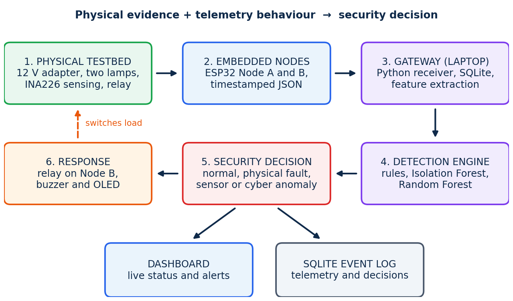

# GridSentinel Edge

Smart Grid Cyberattack Detection Using AI.

A 12 V DC testbed with two lamps, two ESP32 nodes and a laptop gateway. Node A meters the whole
feeder, Node B meters a relay-switched lamp. Both send timestamped JSON over Wi-Fi. The gateway
stores everything in SQLite, runs rule checks plus an Isolation Forest and a Random Forest, and
decides whether a disturbance is a physical fault, a sensor problem or manipulated data.
A Streamlit dashboard shows the state and runs the experiments.



## Folder layout

```
firmware/
  node_a/            Node A sketch: INA226-A, voltage sensor on GPIO34
  node_b/            Node B sketch: INA226-B, relay, buzzer, OLED, command polling
  tools/             i2c_scanner and ina226_check, for bring-up and debugging
gateway/             FastAPI app (main.py), engine, SQLite layer, settings loader
detection/           features, rules, decision, models, plus calibrate / train / evaluate
scenarios/           injector used by the experiments (FDI, drift, replay, interruption)
dashboard/           Streamlit app, stylesheet, data helpers
tools/               simulate.py (software test only) and export_csv.py
tests/               unit tests and a full run through the gateway core
data/                database, baseline.json, trained models, reports (created at run time)
docs/                wiring notes, API, diagrams
config.toml          thresholds and settings
```

## First run

Python 3.11 or newer.

```
python -m venv venv
venv\Scripts\activate            # Linux/macOS: source venv/bin/activate
pip install -r requirements.txt
```

**Firmware.** In the Arduino IDE install the ESP32 board package, then the libraries
ArduinoJson (version 7), Adafruit SSD1306 and Adafruit GFX. In each of `firmware/node_a` and
`firmware/node_b`, copy `secrets.example.h` to `secrets.h` and fill in the Wi-Fi name, password
and the laptop address. Board: ESP32 Dev Module. Upload `node_a` to ESP32 #1 and `node_b` to ESP32 #2.

**Gateway** (leave it running, allow Python through the Windows firewall when asked):

```
python -m uvicorn gateway.main:app --host 0.0.0.0 --port 8000
```

**Dashboard** (second terminal):

```
python -m streamlit run dashboard/app.py
```

The `python -m` form matters on managed laptops: a Device Guard policy can block the `uvicorn.exe` and
`streamlit.exe` launchers in the venv, but it does not block `python` itself.

## Recording data and training

1. Dashboard, Experiments tab: start a **Normal operation** run. Keep lamp 2 off for a minute or two,
   switch it on from the Live tab for a minute or two, then stop the run.
2. `python -m detection.calibrate` learns lamp 1 current and the normal ranges. Restart the gateway.
3. Record each scenario at least three times (the evaluation splits by run): physical fault,
   false data injection, sensor drift, replay, communication interruption.
4. `python -m detection.train` trains both models. Restart the gateway.
5. `python -m detection.evaluate` scores the models on runs they did not see and writes a report
   to `data/reports/`.
6. `python tools/export_csv.py` writes the tables to `data/exports/` for the report.

## What you fill in

| Where | What | How to get it |
|---|---|---|
| `firmware/node_*/secrets.h` | Wi-Fi name, password, `GATEWAY_URL` | laptop address from `ipconfig`, port 8000 |
| `firmware/node_b/config.h` | `RELAY_ACTIVE_LOW` | test the relay with no lamp: click on HIGH means false, click on LOW means true |
| `firmware/node_a/config.h` | `VSENSE_TRIM` | multimeter reading at the hub divided by the dashboard voltage-sensor reading |
| `config.toml` | thresholds marked "tune" | adjust after your first normal run, watch the Live tab for false alarms |
| `data/baseline.json` | lamp 1 current and normal ranges | created by `detection.calibrate` |
| `data/models/` | trained models | created by `detection.train` |

## When no readings show up

Work from the bottom of the stack upwards.

1. `firmware/tools/i2c_scanner`: expect 0x40 on both nodes and 0x3C on Node B. Nothing means a wiring problem.
2. `firmware/tools/ina226_check`: bus voltage should be about 12 V. Current is positive with the lamp on.
   A negative current means IN+ and IN− are swapped.
3. Serial monitor on the node sketch: the last word on each line is `sent` or `not sent`.
   `not sent` is Wi-Fi, the gateway address or the firewall.
4. Open `http://<laptop address>:8000/status` in a browser. Nodes appear there as soon as a message arrives.

## Running with one INA226

If only one INA226 works, fit it on the feeder (Node A) and run in one-meter mode:

1. `config.toml`: set `branch_meter = false` under `[sensing]`.
2. `firmware/node_b/config.h`: set `HAS_INA = false` and upload Node B again.
3. Record the normal run with lamp 2 off for a while and on for a while, then `python -m detection.calibrate`.
   It learns lamp 1 and the current lamp 2 adds.

The feeder current is then checked against what the relay state says it should be, and the INA226 bus
voltage is still checked against the voltage sensor. Replay, link loss, drift and manipulated values
are still caught. What this mode cannot do is tell a physical fault from manipulated current, because
there is no second current measurement to compare with. Say so when you present it.

## On a managed Windows laptop

Some college laptops run an Application Control (Device Guard) policy. It can block the `.exe` launchers
in the venv, which is why the commands above use `python -m`, and it can also block newly released
compiled packages with a message like "DLL load failed ... An Application Control policy has blocked
this file". If that happens:

1. Check which package is blocked: `python -c "import numpy"`, then the same for `pandas`, `pyarrow`, `pydantic_core`.
2. Try the previous release of the blocked one, for example `pip install pandas==2.3.3`.
3. Still blocked: install Python 3.12 from python.org and use `requirements-compat.txt` in a fresh venv.
4. Still blocked: run the gateway and dashboard on a laptop that is not managed. The ESP32 boards only
   need the gateway address, so they work with any computer on the same Wi-Fi.

The gateway needs only numpy, pydantic and FastAPI until you train models. pandas and scikit-learn are
loaded only by the dashboard and the training commands.

## Behaviour worth knowing

- Lamp 1 is the base load and stays connected. A physical fault is a change of lamp 2 made by hand.
- Two 5 W lamps draw about 0.83 A, right at the INA226 limit of 0.82 A with the 0.1 ohm shunt, so Node A
  can clip. The residual check has enough tolerance for that, but measure one lamp alone first.
- Commanded relay changes are ignored by the step checks for `relay_settle_s` seconds.
- `tools/simulate.py` exists to try the software without hardware. Its data is tagged `simulator` and the
  dashboard says so. Do not train or report from it.
- Until the models exist, decisions come from the rule checks alone.

## Tests

```
pip install -r requirements-dev.txt
python -m pytest
```
