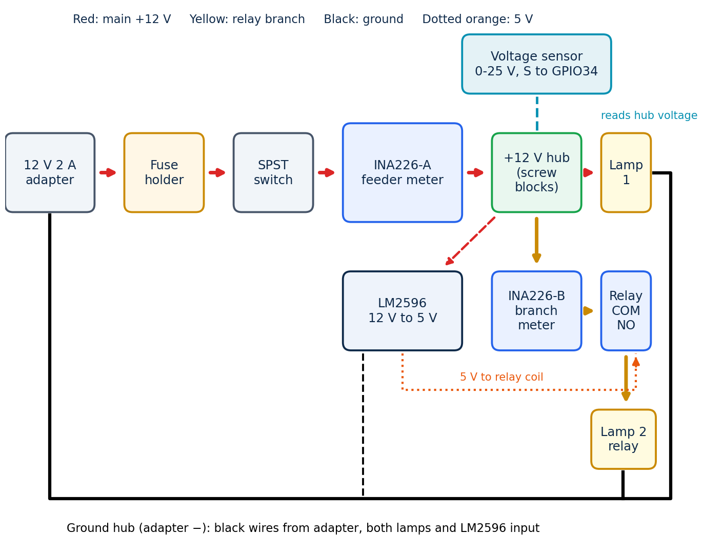

# Wiring notes

Quick reference for the build. The 3D guide has the step-by-step version.

## Wire colours

| Colour | Use |
|---|---|
| Red 22 AWG | main +12 V: adapter, fuse, switch, INA226-A, hub, lamp 1, LM2596 input |
| Yellow 22 AWG | relay branch +12 V: hub, INA226-B, relay COM, relay NO, lamp 2 |
| Black 22 AWG | every power ground, into the GND hub |
| Jumpers | 3.3 V logic and signals on the breadboards |

## ESP32 pins

| Pin | Node A | Node B |
|---|---|---|
| 3V3 | INA226-A VCC | INA226-B VCC, OLED VDD, buzzer VCC |
| GND | INA226-A GND, voltage sensor − | INA226-B GND, OLED GND, buzzer GND, relay GND |
| GPIO21 | SDA | SDA |
| GPIO22 | SCL | SCL |
| GPIO34 | voltage sensor S | |
| GPIO26 | | relay IN |
| GPIO27 | | buzzer I/O |

I2C addresses: INA226 0x40 on each node, OLED 0x3C on Node B. The OLED pin marked SCK is the I2C clock.

## Hubs

Two 2-pin 5.08 mm screw blocks snapped together give four terminals. The terminals of a block are
separate, so solder one bare wire across all four pins on the underside, then check with the
multimeter that every terminal beeps to every other one. At most two wires under one screw.

| +12 V hub | |
|---|---|
| 1 | from INA226-A IN−, and the voltage sensor VCC |
| 2 | lamp 1 + |
| 3 | INA226-B IN+ (yellow) |
| 4 | LM2596 IN+ |

| GND hub | |
|---|---|
| 1 | adapter −, and the voltage sensor GND |
| 2 | lamp 1 − |
| 3 | lamp 2 − and LM2596 IN− |
| 4 | link to the breadboard GND rails |

## Before first power-up

Continuity first, adapter unplugged: fuse, switch, every hub, no beep between the +12 V and GND hubs.
Then with the adapter on and nothing else connected: about 12 V at the hub, LM2596 output set to
5.00 V, 3.3 V at the ESP32 3V3 pin, and 2.4 V (not above 3.0 V) on the voltage sensor S pin.
